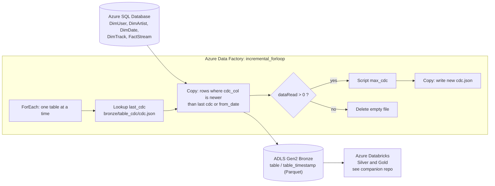

# Spotify Data Platform: Azure Data Factory Orchestration

Parameterized, incremental ingestion on Azure. One pipeline loops over a list of source tables and loads only new or changed rows from Azure SQL Database into the Bronze layer of ADLS Gen2 as Parquet. It tracks a **change-column watermark** per table, supports a **per-table backfill date**, and cleans up after runs that find no new data. Adding a table means adding one entry to the table list, not building a new pipeline.

**Stack:** Azure Data Factory · Azure SQL Database · ADLS Gen2 · Azure Logic Apps · Azure Databricks (downstream) · GitHub

> **Companion repo:** the Databricks side (Bronze to Silver to Gold, Auto Loader, Delta Lake, Unity Catalog, SCD Type 2, Asset Bundles) is in [spotify-azure-data-engineering](https://github.com/MichaelJohnsonlmj/spotify-azure-data-engineering). This repo covers only the ADF ingestion layer.

---

## Table of contents

1. [Architecture](#architecture)
2. [Key features](#key-features)
3. [Source data](#source-data)
4. [Repository structure](#repository-structure)
5. [Pipelines](#pipelines)
6. [Incremental load logic](#incremental-load-logic)
7. [Backfill](#backfill)
8. [Looping over tables](#looping-over-tables)
9. [Email alerting (Logic Apps)](#email-alerting-logic-apps)
10. [Setup guide](#setup-guide)
11. [How to run](#how-to-run)
12. [How to add a new table](#how-to-add-a-new-table)
13. [Design decisions](#design-decisions)
14. [Future improvements](#future-improvements)

---

## Architecture



**Data flow**

1. The pipeline receives an array of tables. Each entry holds the schema, table, change column and an optional `from_date`.
2. The **ForEach** loop takes one table at a time.
3. A **Lookup** reads the last loaded watermark from `bronze/<table>_cdc/cdc.json`.
4. A **Copy** reads only rows newer than that watermark and writes a timestamped Parquet file to `bronze/<table>/`.
5. If rows were read, a **Script** finds the new maximum change value and a **Copy** saves it as the next watermark. If no rows were read, the empty file is deleted and the watermark is left unchanged.
6. Databricks picks up the Bronze files with Auto Loader (see the companion repo).

---

## Key features

- **Parameterized and loop-driven:** one pipeline serves all 5 tables, driven by an array parameter (`forloo`).
- **Incremental ingestion:** a per-table watermark stored as `cdc.json` in ADLS means each run copies only new or changed rows.
- **Per-table change columns:** `updated_at` for most tables, `date` for `DimDate` and `stream_timestamp` for `FactStream`.
- **Backfill on demand:** setting `from_date` for a table overrides the stored watermark, so history can be reloaded without editing the pipeline.
- **Clean empty runs:** if a table has no new rows, the empty Parquet file is deleted and the watermark is not moved.
- **Reusable single-table pipeline:** `incremental_loader` runs the same logic for one table through pipeline parameters.
- **Email alerts:** Azure Logic Apps sends a status email for pipeline runs.
- **Source control:** the factory is connected to GitHub, so pipelines, datasets and linked services are versioned in this repo.
- **Separation of concerns:** ADF handles ingestion. Databricks handles transformation.

---

## Source data

Azure SQL Database holds five Spotify-style tables.

| Table | Type | Change column |
|---|---|---|
| `DimUser` | Dimension | `updated_at` |
| `DimTrack` | Dimension | `updated_at` |
| `DimArtist` | Dimension | `updated_at` |
| `DimDate` | Dimension | `date` |
| `FactStream` | Fact | `stream_timestamp` |

> The data is synthetic or sample data. No real user data is used.

---

## Repository structure

```
.
├── pipeline/          # incremental_forloop.json, incremental_loader.json
├── dataset/           # azure_sql, parquet_dynamic, Json_dynamic
├── linkedService/     # Azure SQL and ADLS Gen2 (no secrets)
├── factory/           # Global parameters
├── docs/              # Architecture diagram and screenshots
└── README.md
```

---

## Pipelines

| Pipeline | Role | Parameters |
|---|---|---|
| `incremental_forloop` | Main pipeline. Loops over the table list and runs the incremental copy logic for each table, one at a time. | `forloo` (array of `schema`, `table`, `cdc_col`, `from_date`) |
| `incremental_loader` | Single-table version of the same logic. Takes the table settings as individual parameters. | `schema`, `table`, `cdc_col`, `from_date` |

### Datasets and linked service

| Name | Type | Purpose |
|---|---|---|
| `azure_sql` | Azure SQL dataset | Source for the Copy activity |
| `parquet_dynamic` | Parquet dataset (parameters: `Container`, `Folder`, `File`) | Bronze output, one folder per table |
| `Json_dynamic` | JSON dataset (parameters: `Container`, `Folder`, `File`) | Reads and writes the `cdc.json` watermark |
| `AzureSqlDatabase1` | Linked service | Runs the `max_cdc` query |

### Activity flow (per table)

```
last_cdc (Lookup)  ─┐
                    ├─► AzureSqltoLake (Copy) ─► incremental_if (If: dataRead > 0)
current (Set var)  ─┘                                 ├─ true : max_cdc (Script) ─► updated_last_cdc (Copy)
                                                      └─ false: Delete empty file
```

---

## Incremental load logic

The pipeline uses a **high-watermark on a change column**.

1. **Read the watermark:** the `last_cdc` Lookup reads `bronze/<table>_cdc/cdc.json`.
2. **Copy only newer rows:** the source query is built from the table settings:

   ```sql
   SELECT *
   FROM <schema>.<table>
   WHERE <cdc_col> > '<from_date if provided, otherwise the last cdc>'
   ```

3. **Write to Bronze:** rows land as Parquet in `bronze/<table>/`, in a file named `<table>_<utc timestamp>`.
4. **Advance the watermark:** only when `dataRead > 0`, a Script activity runs `SELECT MAX(<cdc_col>)` and a Copy writes that value to `cdc.json`. The next run starts from there.
5. **No new data:** the empty Parquet file is deleted and the watermark stays where it was.

---

## Backfill

Each entry in the table list has a `from_date` field.

- **Normal run:** leave `from_date` empty (`""`). The pipeline uses the stored watermark.
- **Backfill:** set `from_date` to a historical date for the table you want to reload. The pipeline then ignores the stored watermark and copies every row newer than that date.
- **What it does not do:** it doesn't delete anything already in Bronze, so a backfill can write rows that already exist. The Silver layer deduplicates them in Databricks.
- **After a backfill:** the watermark moves to the latest change value, so normal incremental runs continue from there.

Example entry:

```json
{ "schema": "dbo", "table": "DimUser", "cdc_col": "updated_at", "from_date": "2024-01-01" }
```

---

## Looping over tables

The `forloo` array parameter drives a **ForEach** activity. Default value:

```json
[
  { "schema": "dbo", "table": "DimUser",    "cdc_col": "updated_at",       "from_date": "" },
  { "schema": "dbo", "table": "DimTrack",   "cdc_col": "updated_at",       "from_date": "" },
  { "schema": "dbo", "table": "DimDate",    "cdc_col": "date",             "from_date": "" },
  { "schema": "dbo", "table": "DimArtist",  "cdc_col": "updated_at",       "from_date": "" },
  { "schema": "dbo", "table": "FactStream", "cdc_col": "stream_timestamp", "from_date": "" }
]
```

Each iteration passes `item().table`, `item().schema` and `item().cdc_col` into the Lookup, Copy and Script activities and into the parameterized datasets, so the same activities serve every table.

The loop runs **sequentially** (`isSequential = true`). The pipeline variable `current` holds the run timestamp, and variables are shared across iterations, so parallel iterations could overwrite each other's value.

---

## Email alerting (Logic Apps)

Azure Logic Apps sends an email with the pipeline status, so a run doesn't need to be watched in ADF Monitor.

> The Logic App URL contains a signature. Keep it in a global parameter or Key Vault, never in the repo.

---

## Setup guide

### Prerequisites

- Azure subscription
- Azure Data Factory, Azure SQL Database, ADLS Gen2, Logic App
- Azure Databricks workspace (for the downstream layers)
- GitHub repo connected to ADF (Git integration)

### Steps

1. **Storage:** create the ADLS Gen2 account and a `bronze` container.
2. **Azure SQL:** create the database and load the five source tables.
3. **Seed the watermark:** for each table, create `bronze/<table>_cdc/cdc.json` containing a `cdc` value with an early date, for example `1900-01-01`. The `last_cdc` Lookup reads this file, so it must exist before the first run.
4. **ADF:** create the linked services (Azure SQL, ADLS Gen2) and the three parameterized datasets, then import the pipelines from this repo.
5. **Logic App:** create the HTTP-triggered workflow and put its URL in a global parameter.
6. **Git:** connect the factory to this repo and publish from the collaboration branch.
7. **Security:** use managed identity or Key Vault for credentials. Don't commit connection strings.

---

## How to run

1. Open ADF Studio, go to **Author**, then `incremental_forloop`.
2. Click **Add trigger**, then **Trigger now**. Keep the default table list, or edit it.
3. Watch **Monitor**, then **Pipeline runs**.
4. For a historical reload, set `from_date` on the table (see [Backfill](#backfill)).
5. Check `bronze/<table>/` for the new Parquet file and `bronze/<table>_cdc/cdc.json` for the updated watermark.

---

## How to add a new table

1. Create the table in Azure SQL Database. It needs a change column that increases when a row changes.
2. Seed `bronze/<table>_cdc/cdc.json` with an early date.
3. Add `{ "schema": ..., "table": ..., "cdc_col": ..., "from_date": "" }` to the `forloo` list.
4. Run the pipeline. No new pipeline or dataset is needed.

---

## Design decisions

| Decision | Reason |
|---|---|
| Keep the watermark as a `cdc.json` file in the lake | State sits next to the data and needs no extra database |
| Advance the watermark only when `dataRead > 0` | A run that finds nothing never moves the watermark |
| Delete the empty Parquet file on no-data runs | Keeps zero-row files out of Bronze, so Auto Loader doesn't pick them up |
| Run the ForEach sequentially | The `current` timestamp variable is shared across iterations |
| Put `cdc_col` and `from_date` in each table entry | Tables use different change columns, and each can be backfilled on its own |
| Use parameterized datasets (`Container`, `Folder`, `File`) | One Parquet dataset and one JSON dataset serve every table |

---

## Future improvements

- Make `incremental_forloop` call `incremental_loader` with an Execute Pipeline activity, so the incremental logic lives in one place
- Add retry policies (all activities currently use `retry = 0`)
- Take the new watermark from the rows just copied, not from a separate `MAX` query, so rows inserted between the copy and the query can't be skipped
- Control and audit tables in Azure SQL, so the table list and every run are stored in a database instead of a pipeline parameter
- Data quality checks before the data reaches Bronze
- Parallel table loading, which first needs the `current` timestamp to be per-iteration
- Automated deployment of the factory between Dev, Test and Prod

---

## Author

**Michael Johnson Louis**: Azure Data Engineer
[LinkedIn](https://www.linkedin.com/in/michael-johnson-louis-0321b5b4/) · [GitHub](https://github.com/MichaelJohnsonlmj)
