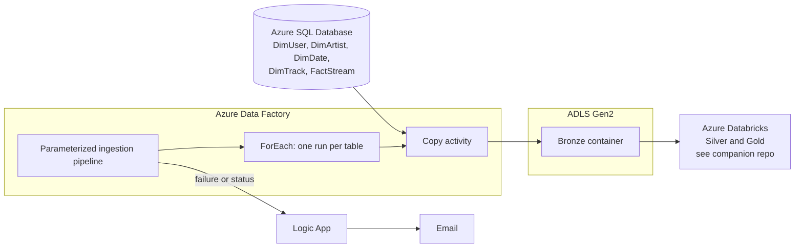

# Spotify Data Platform: Azure Data Factory Orchestration

Parameterized, loop-driven ingestion on Azure. One pipeline loops over a list of source tables and loads each one from Azure SQL Database into ADLS Gen2, with **incremental loads**, a **backfill option** and **Logic Apps email alerts**. Adding a table means adding an entry to the list, not building a new pipeline.

**Stack:** Azure Data Factory · Azure SQL Database · ADLS Gen2 · Azure Logic Apps · Azure Databricks (downstream) · GitHub

> **Companion repo:** the Databricks side (Bronze to Silver to Gold, Delta Lake, Unity Catalog, SCD Type 2, Asset Bundles) is in [spotify-azure-data-engineering](https://github.com/MichaelJohnsonlmj/spotify-azure-data-engineering). This repo covers only the ADF ingestion layer.

> **Before publishing:** search this file for `[FILL IN` and replace each marker with the real value from your ADF factory. Delete any section that doesn't match what you built.

---

## Table of contents

1. [Architecture](#architecture)
2. [Key features](#key-features)
3. [Source data](#source-data)
4. [Repository structure](#repository-structure)
5. [Pipelines](#pipelines)
6. [Incremental load logic](#incremental-load-logic)
7. [Backfill](#backfill)
8. [Looping over tables](#looping-over-tables)
9. [Email alerting (Logic Apps)](#email-alerting-logic-apps)
10. [Setup guide](#setup-guide)
11. [How to run](#how-to-run)
12. [How to add a new table](#how-to-add-a-new-table)
13. [Challenges and lessons learned](#challenges-and-lessons-learned)
14. [Future improvements](#future-improvements)
15. [Acknowledgements](#acknowledgements)

---

## Architecture



**Data flow**

1. The pipeline receives a list of source tables (and the load mode) as parameters.
2. A **ForEach** loop runs the same Copy logic for each table.
3. Each table is copied from Azure SQL Database into the **Bronze** container in ADLS Gen2.
4. Databricks picks up the Bronze files with Auto Loader (see the companion repo).
5. A **Logic App** sends an email with the pipeline status.

---

## Key features

- **Parameterized pipelines:** table names and load settings are parameters, so nothing is hardcoded per table.
- **ForEach looping:** one pipeline handles all 5 source tables.
- **Incremental ingestion:** only new or changed rows are copied after the first load. [FILL IN: watermark column or CDC method]
- **Backfill option:** a parameter lets you reload historical data on demand without editing the pipeline.
- **Email alerts:** Logic Apps sends a status email for each run.
- **Source control:** the factory is connected to GitHub, so every pipeline, dataset and linked service is versioned in this repo.
- **Separation of concerns:** ADF handles ingestion and orchestration. Databricks handles transformation.

---

## Source data

Azure SQL Database holds five Spotify-style tables.

| Table | Type | Description |
|---|---|---|
| `DimUser` | Dimension | Listener profile data |
| `DimArtist` | Dimension | Artist details |
| `DimTrack` | Dimension | Track details |
| `DimDate` | Dimension | Calendar attributes |
| `FactStream` | Fact | Individual streaming events |

> The data is synthetic or sample data. No real user data is used.

---

## Repository structure

> Adjust to match your repo.

```
.
├── pipeline/          # ADF pipeline JSON
├── dataset/           # ADF datasets (parameterized)
├── linkedService/     # Linked services (no secrets)
├── factory/           # Global parameters
├── docs/              # Architecture diagram and screenshots
└── README.md
```

---

## Pipelines

| Pipeline | Role | Parameters |
|---|---|---|
| [FILL IN: main pipeline name] | Entry point. Loops over the table list and runs the copy logic for each table. | [FILL IN: for example table list, load mode, backfill flag] |
| [FILL IN: alert pipeline or activity name] | Calls the Logic App to send the status email. | [FILL IN] |

### Activity flow

```
[FILL IN: Lookup / Set variable / If condition, if used]
        ▼
ForEach (table list)
        ▼
   Copy: Azure SQL ─► ADLS Gen2 Bronze
        ▼
Web activity ─► Logic App (email)
```

---

## Incremental load logic

[FILL IN: describe how your pipeline decides what to copy. Use the one that matches your build.]

- **Watermark approach:** the last loaded value of `[FILL IN: column]` is stored in `[FILL IN: where]`. Each run copies only rows with a higher value, then updates the stored value after a successful copy.
- **CDC approach:** [FILL IN: how changes are detected and where the state is kept]
- **First run:** loads the full table.

---

## Backfill

A backfill parameter reloads historical data without changing the pipeline.

- **How it works:** [FILL IN: for example, when the parameter is set, the pipeline ignores the stored watermark and uses the start date you pass in]
- **When to use it:** after a failed load, a source correction, or when onboarding a table with history.
- **How to run it:** trigger the pipeline and set `[FILL IN: parameter name]` to `[FILL IN: value]`.

---

## Looping over tables

The pipeline uses a **ForEach** activity over an array parameter, for example:

```json
[FILL IN: your real array, for example table names and any per-table settings]
```

Each iteration passes the table name into a parameterized dataset, so one Copy activity serves all five tables. Set the ForEach to run in parallel (`isSequential = false`) with a `batchCount` of `[FILL IN]`.

---

## Email alerting (Logic Apps)

The pipeline calls an HTTP-triggered Logic App with a **Web activity** (`POST`, `Content-Type: application/json`).

```json
{
  "subject": "[FILL IN: example subject]",
  "pipeline": "[FILL IN]",
  "status": "[FILL IN]",
  "run_id": "[FILL IN]"
}
```

- The Logic App formats the message and sends it by email.
- The Logic App URL contains a signature. Keep it in a global parameter or Key Vault, never in the repo.

---

## Setup guide

### Prerequisites

- Azure subscription
- Azure Data Factory, Azure SQL Database, ADLS Gen2, Logic App
- Azure Databricks workspace (for the downstream layers)
- GitHub repo connected to ADF (Git integration)

### Steps

1. **Storage:** create the ADLS Gen2 account and a `bronze` container.
2. **Azure SQL:** create the database and load the five source tables.
3. **ADF:** create linked services (Azure SQL, ADLS Gen2), then parameterized datasets, then import the pipelines from this repo.
4. **Logic App:** create the HTTP-triggered workflow and put its URL in a global parameter.
5. **Git:** connect the factory to this repo and publish from the collaboration branch.
6. **Security:** use managed identity or Key Vault for credentials. Don't commit connection strings.

---

## How to run

1. Open ADF Studio, go to **Author**, then the main pipeline.
2. Click **Add trigger**, then **Trigger now**, and set the parameters.
3. Watch **Monitor**, then **Pipeline runs**.
4. For a historical reload, set the backfill parameter (see [Backfill](#backfill)).

---

## How to add a new table

1. Create the table in Azure SQL Database.
2. Add the table to the ForEach list parameter. [FILL IN: and any per-table settings]
3. Run the pipeline. No new pipeline or dataset is needed.

---

## Challenges and lessons learned

> Replace this with 3 to 5 problems you actually hit. Real examples impress recruiters more than anything else in this README.

| Problem | Cause | Fix |
|---|---|---|
| [FILL IN] | [FILL IN] | [FILL IN] |
| [FILL IN] | [FILL IN] | [FILL IN] |
| [FILL IN] | [FILL IN] | [FILL IN] |

---

## Future improvements

- Control and audit tables in Azure SQL to log every run and table
- Data quality checks before the data reaches Bronze
- Retry policies and alert escalation for repeated failures
- Automated deployment of the factory between Dev, Test and Prod
- Parameterized scheduling with a daily trigger

---

## Acknowledgements

> If you built this project by following a course or tutorial, say so here and name it. Then list what you added or changed. Recruiters value this honesty.

Built following [FILL IN: course or tutorial name, if any]. Changes and additions of my own: [FILL IN].

---

## Author

**Michael Johnson Louis**: Azure Data Engineer
[LinkedIn](https://www.linkedin.com/in/michael-johnson-louis-0321b5b4/) · [GitHub](https://github.com/MichaelJohnsonlmj)
